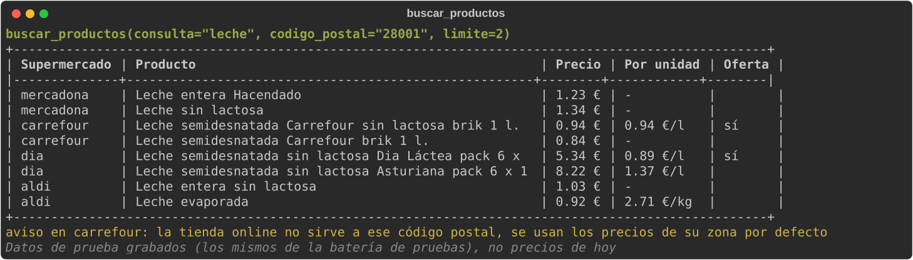
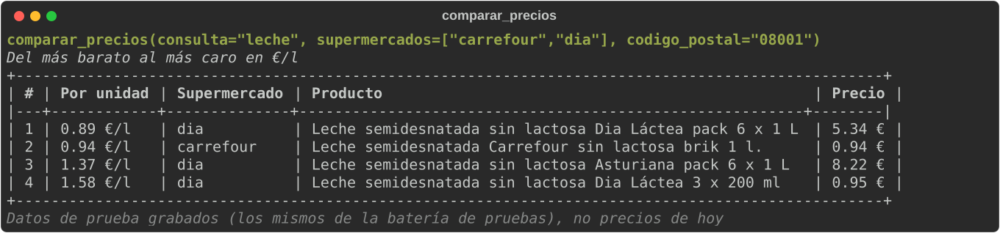
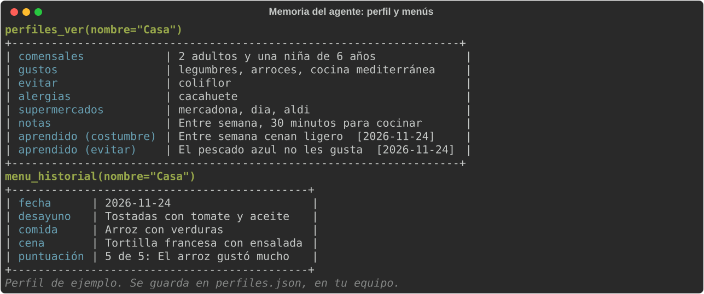
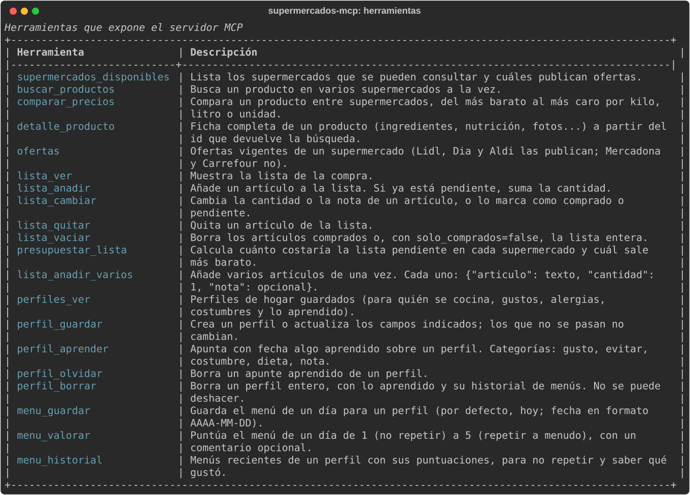

# chef-compra

Agente que planifica el menú diario de tu casa y prepara la cesta de la compra con precios reales de los supermercados de España. Funciona sobre un servidor MCP propio, `supermercados-mcp`, que consulta los catálogos de **Mercadona, Carrefour, Dia, Lidl y Aldi**.

- Pregunta para quién es el menú, qué os gusta, qué queréis evitar, alergias, dieta y costumbres.
- Lo recuerda y aprende: apunta lo que le vas diciendo, guarda cada menú y su puntuación, y no repite platos.
- Busca cada ingrediente en los supermercados, compara precios por kilo o litro y calcula cuánto cuesta la cesta en cada tienda.

Solo lee los catálogos públicos de cada web. No inicia sesión, no toca carritos y no compra nada. Todos tus datos se quedan en tu equipo.

> Proyecto personal y no oficial, sin relación con ninguna de las cadenas. Usa APIs sin documentar que pueden cambiar sin aviso.

## Índice

- [Cómo funciona](#cómo-funciona)
- [Capturas](#capturas)
- [Instalación](#instalación)
- [Probarlo antes de usarlo](#probarlo-antes-de-usarlo)
- [Conectarlo a Claude](#conectarlo-a-claude)
- [Usar el agente](#usar-el-agente)
- [Herramientas](#herramientas)
- [Configuración](#configuración)
- [Dónde se guardan los datos](#dónde-se-guardan-los-datos)
- [Limitaciones](#limitaciones)
- [Estructura del proyecto](#estructura-del-proyecto)
- [Estado de las pruebas](#estado-de-las-pruebas)
- [Licencia y créditos](#licencia-y-créditos)

## Cómo funciona

```
Tú  <->  Claude (agente chef-compra)  <->  supermercados-mcp  <->  webs de los supermercados
                                                  |
                                     lista.json y perfiles.json (en tu equipo)
```

Hay dos piezas:

1. **El servidor MCP** (`supermercados-mcp`). Da a Claude 20 herramientas: buscar y comparar productos, ver ofertas, llevar la lista de la compra y guardar perfiles de hogar y menús.
2. **El agente** (`chef-compra`). Son las instrucciones que le dicen a Claude cómo usar esas herramientas: cuándo preguntar, cómo proponer el menú, cómo montar la cesta y qué apuntar para la próxima vez.

Una sesión típica:

1. El agente mira si ya te conoce. Si no, hace una entrevista corta.
2. Consulta los menús de los últimos días y sus puntuaciones y propone desayuno, comida y cena.
3. Cuando das el visto bueno, guarda el menú, saca los ingredientes y pregunta qué tienes ya en casa.
4. Pasa lo que falta a la lista y la presupuesta en tus supermercados.
5. Te da la cesta por tienda (producto, precio, enlace y total) y te dice dónde sale más barata.
6. Otro día te pregunta qué tal salió, lo puntúa y lo tiene en cuenta.

## Capturas

Las capturas son salidas reales del servidor, generadas con `scripts/capturas.py`. Las tiendas están sustituidas por las respuestas grabadas que usa la batería de pruebas, así que **los productos y precios son datos de prueba, no precios de hoy**.

Todavía no hay capturas de una conversación con el agente ni de la cesta completa con datos en vivo. Ver [Estado de las pruebas](#estado-de-las-pruebas).

**Buscar un producto en varios supermercados a la vez**



**Comparar por precio por litro**



**Lo que el agente recuerda de tu casa**



**Herramientas que ve Claude**



**Pruebas**


## Instalación

Necesita Python 3.11 o superior.

```bash
git clone https://github.com/jonbondani/chef-compra.git
cd chef-compra
python3 -m venv .venv
.venv/bin/pip install -e ".[dev]"
```

## Probarlo antes de usarlo

```bash
# 1. Pruebas sin red: lógica, protocolo MCP y lectura de respuestas grabadas de las tiendas
scripts/preparar_pruebas.sh
.venv/bin/python -m pytest

# 2. Prueba en vivo contra las tiendas reales, con tu código postal
.venv/bin/python scripts/prueba_en_vivo.py 28001
```

La prueba en vivo arranca el servidor como lo hará Claude, llama a las herramientas y dice qué tienda responde y cuál no. Usa una carpeta temporal, así que no toca tu lista ni tus perfiles.

## Conectarlo a Claude

**Claude Code**

```bash
claude mcp add supermercados -e SUPERMERCADOS_CP=28001 -- "$PWD/.venv/bin/supermercados-mcp"
```

El servidor tiene que llamarse `supermercados`: el agente solo tiene permiso para las herramientas de ese nombre.

**Claude Desktop** (`~/Library/Application Support/Claude/claude_desktop_config.json` en macOS)

```json
{
  "mcpServers": {
    "supermercados": {
      "command": "/ruta/a/chef-compra/.venv/bin/supermercados-mcp",
      "env": { "SUPERMERCADOS_CP": "28001" }
    }
  }
}
```

**Como conector remoto** (claude.ai web o móvil)

El servidor puede servir por HTTP, pero **no trae autenticación** y es de un solo usuario. No lo publiques en internet tal cual: quien llegue a la URL podría leer y cambiar tus perfiles.

```bash
.venv/bin/supermercados-mcp --http --port 8765     # escucha solo en 127.0.0.1
```

## Usar el agente

**En Claude Code**

```bash
mkdir -p ~/.claude/agents
.venv/bin/supermercados-mcp --agente > ~/.claude/agents/chef-compra.md
claude --agent chef-compra
```

Arráncalo con `--agent` para que sea él quien converse contigo. Si Claude lo usa como subagente delegado no puede hacerte preguntas. El agente solo accede a las herramientas de este servidor: no toca ficheros ni la terminal.

**En Claude Desktop**

El servidor publica el mismo agente como prompt `chef_compra`. Elígelo en el menú de prompts del servidor al empezar un chat.

**Qué pregunta la primera vez**

| Pregunta | Dónde lo guarda |
| --- | --- |
| Para quién es: nombre del perfil, cuántas personas y edades | `comensales` |
| Qué os gusta: platos, cocinas, ingredientes | `gustos` |
| Qué queréis evitar | `evitar` |
| Alergias e intolerancias, preguntadas aparte | `alergias` |
| Dieta: vegetariana, sin cerdo, etc. | `dieta` |
| Costumbres: qué comidas hacéis en casa, horarios, tiempo para cocinar | `notas` |
| Código postal, supermercados y presupuesto semanal | `supermercados`, `presupuesto_semanal` |

**Cómo aprende**

- Apunta con fecha lo que le dices y sirve para otros días ("los lunes llego tarde", "el pescado azul no nos gusta") y te avisa de lo que apunta para que puedas corregirlo.
- Si rechazas un plato, pregunta el motivo y apunta el motivo, no solo el plato.
- Puntúa cada menú de 1 a 5. Repite de vez en cuando lo que tuvo 4 o 5 y no vuelve a proponer lo que tuvo 1 o 2.
- No apunta cosas de un solo día ni nada que no hayas dicho tú. Puedes pedirle que olvide cualquier apunte.

**Seguridad alimentaria**

- Las alergias son una restricción absoluta en sus instrucciones. Aun así, depende de que el modelo las siga y de que la tienda publique los ingredientes. **La etiqueta del envase es la que manda.**
- No es nutricionista ni médico. Si la dieta responde a una condición de salud, te pide las pautas de tu profesional y se ciñe a ellas.
- No propone dietas muy restrictivas, ayunos ni objetivos de calorías para adelgazar.

## Herramientas

**Supermercados**

| Herramienta | Qué hace |
| --- | --- |
| `buscar_productos` | Busca un producto en varias tiendas a la vez: precio, precio por kg/l/ud, formato, ofertas y enlace |
| `comparar_precios` | Ordena los resultados de todas las tiendas del más barato al más caro por kg, litro o unidad |
| `detalle_producto` | Ficha completa: ingredientes, nutrición, fotos, EAN (lo que publique cada tienda) |
| `ofertas` | Ofertas vigentes de Lidl, Dia y Aldi, con filtro por texto |
| `supermercados_disponibles` | Qué tiendas hay y cuáles publican ofertas |

**Lista de la compra**

| Herramienta | Qué hace |
| --- | --- |
| `lista_ver`, `lista_anadir`, `lista_anadir_varios` | Ver la lista y añadir artículos, de uno en uno o en lote |
| `lista_cambiar`, `lista_quitar`, `lista_vaciar` | Cambiar cantidad o nota, marcar como comprado, quitar o vaciar |
| `presupuestar_lista` | Cuánto cuesta la lista pendiente en cada tienda y cuál sale más barata con todo |

**Memoria del agente**

| Herramienta | Qué hace |
| --- | --- |
| `perfiles_ver`, `perfil_guardar`, `perfil_borrar` | Perfiles de hogar: comensales, gustos, qué evitar, alergias, dieta, supermercados, presupuesto |
| `perfil_aprender`, `perfil_olvidar` | Apuntes con fecha de lo que el agente va aprendiendo |
| `menu_guardar`, `menu_valorar`, `menu_historial` | Menú de cada día, su puntuación de 1 a 5 y el historial |

Además de las cinco cadenas principales, la búsqueda acepta por nombre Consum, Alcampo, Eroski, Ahorramás, Caprabo, Bonpreu, BonÀrea, Condis y Plusfresc. Esas nueve no tienen pruebas propias en este proyecto.

## Configuración

| Variable | Para qué | Por defecto |
| --- | --- | --- |
| `SUPERMERCADOS_CP` | Código postal cuando la herramienta no recibe uno | ninguno |
| `SUPERMERCADOS_MCP_DATOS` | Carpeta de la lista de la compra y de los perfiles | `~/.supermercados-mcp` |
| `SUPERMERCADOS_LIDL_FAMILIA` | `grocery` (alimentación), `shop` (bazar) o `todo` | `grocery` |
| `SUPERMERCADOS_TIMEOUT` | Segundos de espera por petición | `15` |

## Dónde se guardan los datos

En `~/.supermercados-mcp`, en dos ficheros JSON legibles a mano:

- `lista.json`: la lista de la compra.
- `perfiles.json`: perfiles de hogar, apuntes aprendidos e historial de menús.

`perfiles.json` puede contener alergias y dietas, que son datos de salud. No salen de tu equipo y no forman parte de este repositorio. Lo que sí sale hacia las webs de las tiendas son las búsquedas de productos y el código postal.

## Limitaciones

- **El código postal importa.** Mercadona no responde sin él, porque cada almacén tiene su surtido y sus precios. Carrefour sin punto de venta puede devolver productos sin precio. Si una tienda online no sirve a tu código postal, se usa su zona por defecto y la respuesta lleva un `aviso`.
- **Aldi y Lidl no venden alimentación online.** Aldi publica su surtido fijo y las ofertas semanales; Lidl, el surtido de tienda y los folletos. Sus precios son de catálogo.
- **El presupuesto es una estimación.** Para cada artículo toma el resultado más relevante de cada tienda, que puede ser otro formato (un pack de 6 frente a una unidad). Cuanto más concreto el texto ("leche entera 1 l"), mejor. Cada línea muestra el producto elegido para poder revisarlo.
- **Ofertas de Lidl.** La versión 0.1.0 de supermercapy tiene un fallo conocido: Lidl cambió la dirección de sus campañas y `ofertas` de Lidl puede devolver un error. Está corregido en el repositorio de la librería y pendiente de publicar. La búsqueda de Lidl no se ve afectada.
- **No compra.** Entrega la cesta lista para que la compres tú.
- **Las webs cambian.** Si una tienda deja de responder, el resto sigue funcionando y la que falla devuelve su error. Lo normal es que se arregle actualizando `supermercapy`.
- **Un solo usuario.** Hay una única lista y un único fichero de perfiles por instalación.
- **Uso personal.** La librería espacia las peticiones a cada tienda y el servidor reutiliza las sesiones para hacer las menos posibles.

## Estructura del proyecto

```
src/supermercados_mcp/
  server.py     herramientas MCP, prompt del agente y línea de comandos
  tiendas.py    acceso a las tiendas con supermercapy; el fallo de una no oculta a las demás
  lista.py      lista de la compra en JSON con escritura atómica
  perfiles.py   perfiles de hogar, apuntes aprendidos e historial de menús
  agente.md     instrucciones del agente (fuente única para Claude Code y para el prompt MCP)
scripts/
  preparar_pruebas.sh   descarga las respuestas grabadas para las pruebas sin red
  prueba_en_vivo.py     prueba de extremo a extremo contra las tiendas reales
  capturas.py           genera las capturas de este README
tests/                  96 pruebas
```

No hay scrapers propios. El acceso a las tiendas lo hace [supermercapy](https://github.com/jtayped/supermercapy), fijada en la versión 0.1.0. El servidor usa el SDK oficial de MCP para Python, versión 2.

## Estado de las pruebas

Probado:

- 96 pruebas sin red, en Python 3.11 y 3.13: lista, perfiles, menús, presupuesto, errores de uso y el recorrido completo de herramientas que sigue el agente.
- Lectura de datos de las cinco tiendas con respuestas grabadas de sus webs reales, incluidos tienda caída y código postal sin cobertura.
- Arranque real del servidor por stdio y por HTTP, y que la memoria se conserva al reiniciarlo.

Sin probar todavía:

- **Las tiendas en vivo.** El entorno donde se desarrolló no tenía acceso a sus webs. Ejecuta `scripts/prueba_en_vivo.py` con tu código postal.
- **La conversación del agente con un modelo real.** Están probadas sus herramientas y que sus instrucciones solo nombran herramientas que existen, no cómo conversa.

## Licencia y créditos

MIT. Ver [LICENSE](LICENSE).

El acceso a los catálogos es obra de [supermercapy](https://github.com/jtayped/supermercapy), de Joel Taylor, también con licencia MIT.
